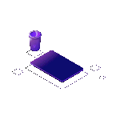
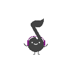

  

<h2 align="center"> Think it. Design it. Make it. </h2>

> I try to build beautiful systems.  
> Masters student in Theory of Computation @AUB  
> Mechatronics engineering graduate @UOB.  
> Currently locking in at 42 and AUB 
> Working through...  
>c - cpp - python

  

---

### Vibe Check
> Music, and the little things.

  

---

### Progress

  

